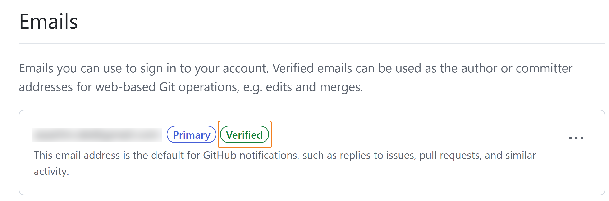
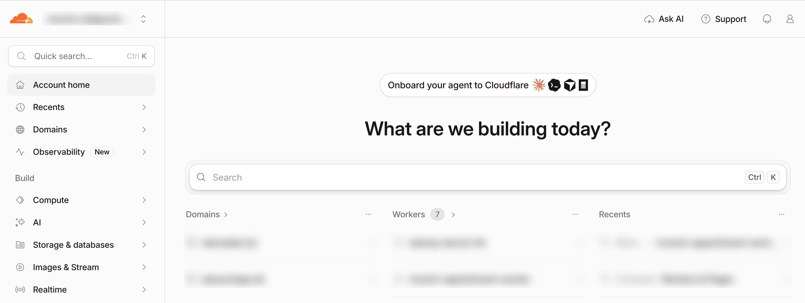

# 0. Before you start

**Goal:** have everything ready so you can start building in the first minute of the workshop.

Please do this **before** the workshop. It takes about 10 minutes.

## What you need

- A laptop (Windows, Mac, Linux or Chromebook). A phone or tablet is not enough.
- A modern browser: Chrome, Edge, Firefox or Safari, updated.
- A **GitHub** account with a verified email.
- A **Cloudflare** account with a verified email.

> [!TIP]
> You do **not** need a credit card. You do **not** need to install anything.

## Step 1: Create a GitHub account

GitHub is where your website's files will live.

1. Go to https://github.com/signup
2. Enter your email, a password and a username. Follow the steps on screen.
3. Open your email inbox and click the verification link from GitHub.
4. Go to https://github.com/settings/emails and check that your email does **not** say "Unverified".

> [!TIP]
> Already have a GitHub account? Just do step 4.

## Step 2: Create a Cloudflare account

Cloudflare is where your website will run.

1. Go to https://dash.cloudflare.com/sign-up
2. Enter your email and a password, then click **Sign up**.
3. Open your email inbox and click the verification link from Cloudflare.
4. Log in at https://dash.cloudflare.com. If Cloudflare asks what you want to do first, you can skip or close that screen.

> [!TIP]
> Already have a Cloudflare account? Just log in and make sure your email is verified (a yellow banner at the top means it is not verified yet).

## Step 3: 5-minute check

Tick every box before the workshop:

- [ ] I can log in to https://github.com and my email is verified.
- [ ] I can log in to https://dash.cloudflare.com and my email is verified.
- [ ] I can open the workshop repo: https://github.com/asazhin-dev/startup-launch-kit
- [ ] I have written down, in one or two sentences, what my startup does and who it is for.
- [ ] I have a one-sentence tagline and 1–2 sentences about what my startup does.

Don't have a startup yet? No problem: the starter site is about a fictional startup, **Plovify** ("Plov as a Service"). You can keep it and tweak it.

## What does the "Deploy to Cloudflare" button do?

In Level 1 you will click one button. Here is what happens behind it, so nothing surprises you:

1. **It asks you to connect GitHub to Cloudflare.** You will see a GitHub page asking to give Cloudflare access. This lets Cloudflare create a repository for you and watch it for changes. Click **Authorize** / **Install**.
2. **It copies the project into a new repository in YOUR GitHub account.** This is your own copy. You can change anything in it.
3. **It creates a Worker in YOUR Cloudflare account.** A Worker is a small program that runs on Cloudflare's network in 330+ cities around the world. Your website runs on it.
4. **It builds and publishes your site.** You get a free web address like `https://startup-launch-kit.<your-cf-account>.workers.dev`.
5. **It sets up automatic updates.** Every time you save (commit) a change in your GitHub repository, Cloudflare rebuilds and republishes your site in about one minute. Developers call this **CI/CD**.

> [!TIP]
> You will not be charged. Everything in this workshop fits in the Cloudflare free plan.

## Optional: for developers

If you already code and prefer your own tools, you can also use GitHub Codespaces or Node.js + Wrangler on your computer (`npx wrangler dev`, `npx wrangler deploy`). This is **not** needed and the workbook does not cover it.

---

Next: [Level 1: Your landing page →](01-level-1-landing-page.md)
