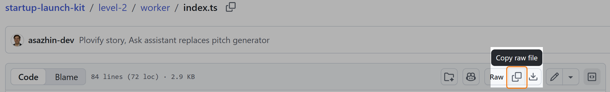
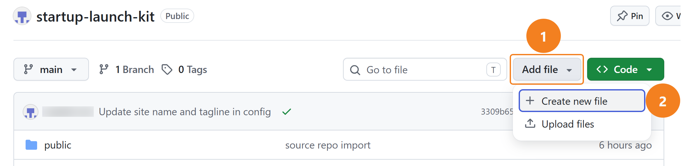
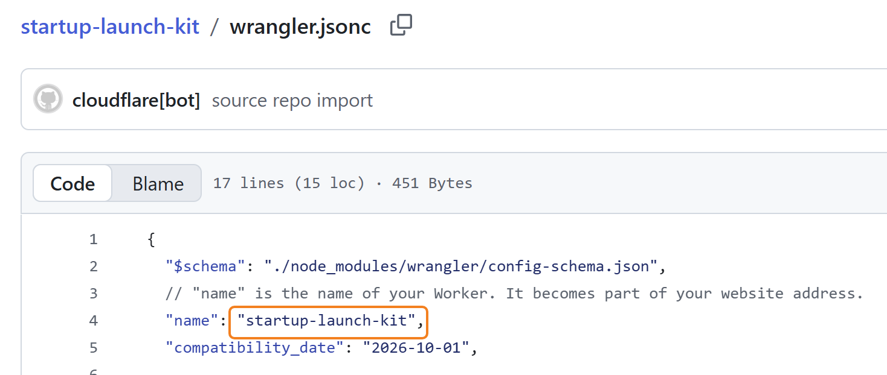
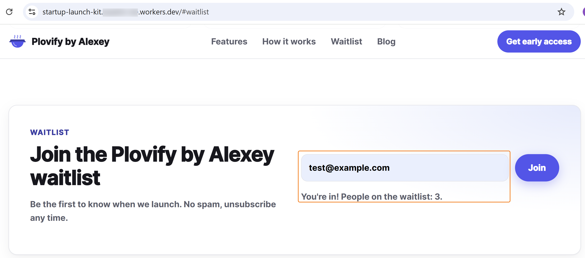
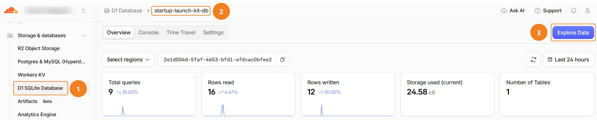
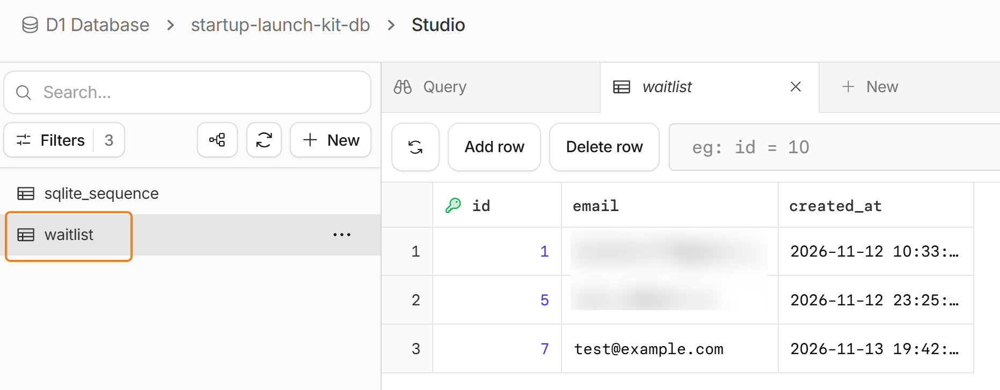
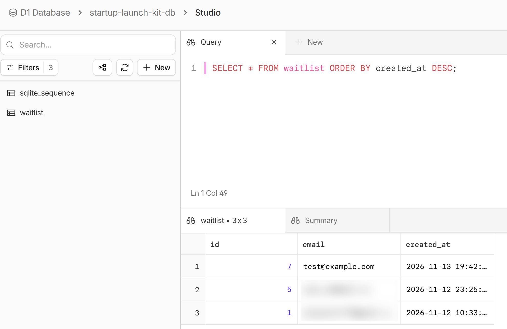

# Level 2: Waitlist and database

**Goal:** let visitors join your waitlist, and store their emails in your own database.

## What you'll build

A "Join the waitlist" form on your landing page. When someone submits their email, a small backend program (an **API**) checks the email and saves it in a SQL database. The page then shows how many people have joined. Only you can see the list of emails, inside your Cloudflare dashboard.

## Building blocks

- **Worker (backend API):** a small program that runs on Cloudflare next to your website. It answers requests to `/api/...` addresses. Everything else is still your static website.
- **D1 database:** a SQL database built into Cloudflare. You will not create it by hand: Cloudflare creates it automatically when you deploy.
- **Bindings:** one line in a settings file that connects your Worker to the database. No passwords or connection strings.

## Before you begin

You will change **3 files** in **your repo**, in this order. The order matters, so that every intermediate save still builds correctly:

1. Add `worker/index.ts` (the backend code, new file)
2. Replace `wrangler.jsonc` (settings: adds the database)
3. Edit `src/config.ts` (turns the form on)

Open two browser tabs:

- **Tab A, the workshop repo:** https://github.com/asazhin-dev/startup-launch-kit/tree/main/level-2
- **Tab B, your repo:** `https://github.com/<your-github-username>/startup-launch-kit` (use your repo name if you changed it)

After **each** commit, wait for the **green check ✓** before you start the next one (about 1 minute). If something breaks, you then know exactly which file caused it.

## Steps

### Part A: Add the backend code

1. In **Tab A** (workshop repo), click the folder `worker`, then the file `index.ts`.
   Direct link: https://github.com/asazhin-dev/startup-launch-kit/blob/main/level-2/worker/index.ts
2. Click the **Copy raw file** button (the icon with two squares, at the top right of the file).
   

3. In **Tab B** (your repo), go to the main page of your repo and click **Add file** → **Create new file**.

   

4. In the file name box, type exactly: `worker/index.ts`
   (When you type the `/`, GitHub creates the folder `worker` automatically. That is expected.)
5. Click in the big empty editor area and paste (Ctrl+V on Windows, Cmd+V on Mac).
6. Click **Commit changes...**, keep **Commit directly to the `main` branch**, and click **Commit changes**.
7. Go to your repo's main page and wait for the **green check ✓** next to your commit (about 1 minute). Your site looks the same as before; that is expected.

### Part B: Replace the settings file

8. In **Tab B** (your repo), open the file `wrangler.jsonc`. Find the line that starts with `"name":` and **write down the value** between the quotes. If you kept the default name in Level 1, it is `startup-launch-kit`.

   

9. In **Tab A** (workshop repo), open `level-2/wrangler.jsonc`.
   Direct link: https://github.com/asazhin-dev/startup-launch-kit/blob/main/level-2/wrangler.jsonc
10. Click **Copy raw file**.
11. In **Tab B**, on your `wrangler.jsonc`, click the **pencil icon** (✏️).
12. **Replace the whole file:** select all (Ctrl+A / Cmd+A), delete, then paste.
13. **Check the `"name"` line.** It must be exactly the value you wrote down in step 8. If it is different, change it now.

> [!WARNING]
> This is the most common mistake in the workshop. If the name does not match your Worker's name, the build fails with a name mismatch error.

14. Click **Commit changes...** → **Commit directly to the `main` branch** → **Commit changes**.
15. Wait for the **green check ✓** next to your commit (about 1–2 minutes; this first build also creates your database).

### Part C: Turn on the waitlist form

16. In **Tab B**, open `src/config.ts` and click the **pencil icon** (✏️).
17. Press Ctrl+F (Cmd+F on Mac) and search for `enableWaitlist` to find this line near the bottom:

    📄 `src/config.ts`
    ```ts
    enableWaitlist: false, // Level 2
    ```

    Change `false` to `true`, so it reads:

    ```ts
    enableWaitlist: true, // Level 2
    ```

    Do not change anything else.
18. Click **Commit changes...** → **Commit directly to the `main` branch** → **Commit changes**.
19. Wait for the **green check ✓** (about 1 minute).

### Part D: Test it

20. Open your live URL and refresh the page (Ctrl+F5 / Cmd+Shift+R). A **Waitlist** link appears in the top menu, and the main button now jumps to a new waitlist section with an email form:

    | | Kept Plovify | Your own startup (`showPlovifyExamples: false`) |
    | --- | --- | --- |
    | Main button | **Reserve your kazan** | **Get early access** |
    | Section title | **Reserve your kazan for wedding season** | **Join the *Your Startup Name* waitlist** |
    | Form button | **Reserve** | **Join** |

21. Enter your email and click the form button. You should see:
    - Plovify: **"You're in! People waiting for plov: 1."**
    - Your own startup: **"You're in! People on the waitlist: 1."**

    

> [!NOTE]
> What happens if the same email signs up twice?
> Try the same email again: the number does not go up (duplicates are ignored). Try a different email: the number goes up.

22. *(Optional, skip if short on time.)* Open your live URL with `/api/waitlist/count` at the end, for example
    `https://startup-launch-kit.<your-cf-account>.workers.dev/api/waitlist/count`
    You should see something like `{"count":2}`. This is your API answering directly.

### Part E: See the emails in your database

The list of emails is private. It is **not** available through your website. You see it in the Cloudflare dashboard:

23. Go to https://dash.cloudflare.com
24. In the left menu, open **Storage & databases** → **D1 SQLite Database** (or type "D1" in the search bar at the top).
25. Click the database **startup-launch-kit-db**, then click **Explore Data** (top right).

    

26. Select the **waitlist** table. You should see your test emails, with the date and time they joined (in UTC).

    

   <details>
   <summary><b>💻 Prefer SQL? Run a query instead</b></summary>
   <br>

   Open the **Query** tab, paste this query and click **Run**:

   ```sql
   SELECT * FROM waitlist ORDER BY created_at DESC;
   ```

   This shows every signup, newest first.

   <p>
     
   </p>

   </details>

## Checkpoint ✅

Join the waitlist on your own page, then paste in the webinar chat:

`Level 2 done: https://startup-launch-kit.<your-cf-account>.workers.dev`

Bonus: join the waitlist of the person who posted before you!

## What just happened

You added a backend API and a SQL database to your website without creating a server, choosing a region or typing a password.

<details>
<summary><b>How it works, and how it compares to AWS</b></summary>
<br>

One line in `wrangler.jsonc` (`d1_databases`) told Cloudflare "this Worker needs a database called `DB`", and Cloudflare created it during the deploy. The Worker creates the `waitlist` table the first time it runs. The setting `run_worker_first: ["/api/*"]` sends `/api/...` requests to your code, while everything else is served as static files.

The free plan includes 100,000 Worker requests per day, and D1 gives you 5 million rows read and 100,000 rows written per day.

**On AWS this would typically need:** API Gateway plus a Lambda function for the API, a database (for example DynamoDB), IAM roles so the function may access the database, and routing `/api` from your website to the API. Each service is configured and billed separately.

**In production:** the same D1 database grows from your first signup to millions of rows; paid usage starts with the $5/month Workers plan. Your prototype is your production: no rewrite, no migration.

</details>

## Stuck?

- See [Troubleshooting](troubleshooting.md), especially "Name mismatch" and "Database not created".
- **Catch-up button.** If you are more than 5 minutes behind, deploy the finished Level 2 as a **new** project and continue from there:

  [](https://deploy.workers.cloudflare.com/?url=https://github.com/asazhin-dev/startup-launch-kit/tree/main/level-2)

  Because you already have a project called `startup-launch-kit`, give the new one a different name, for example `startup-launch-kit-l2`, for both the repository and the Worker. On the Deploy screen, **keep the suggested database settings**.

  The catch-up app uses the same database name (`startup-launch-kit-db`), so it connects to the database you may already have. If you see emails from your earlier tests in the waitlist, that's fine and expected: nothing is lost or duplicated.

  After it deploys, use the **new** repo and the **new** URL from now on, and copy your texts into its `src/config.ts` again (see [How to use the catch-up buttons](troubleshooting.md#how-to-use-the-catch-up-buttons)).

---

Next: [Level 3: AI assistant →](03-level-3-ai-assistant.md)
