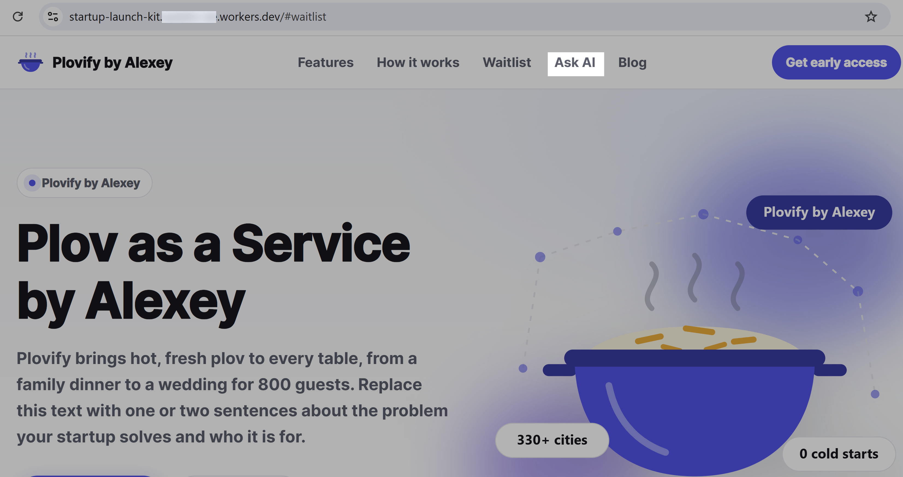
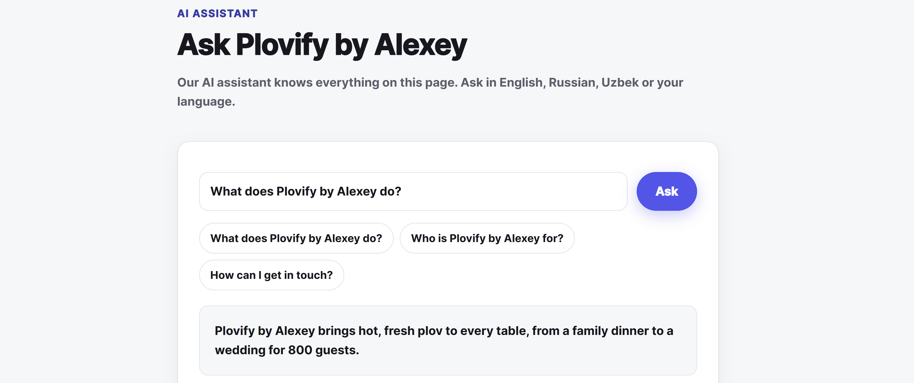
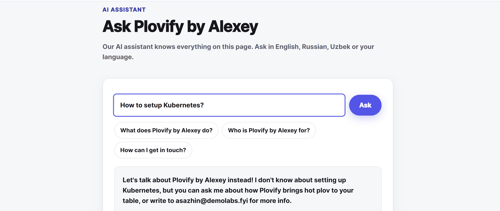

# Level 3: AI assistant

**Goal:** add an AI assistant to your site that answers visitors' questions about your startup, in their own language.

## What you'll build

A new **Ask <your startup's name>** section, for example **Ask Plovify** (it always uses the `name` from `src/config.ts`). A visitor types one question, or clicks a suggested question, and gets a short answer a few seconds later. The assistant only knows what is on your website: it reads the same `src/config.ts` you edited in Level 1 (name, tagline, description, contact email, plus features, menu, steps and FAQ if you added any; with `showPlovifyExamples: true` it also knows the Plovify menu and FAQ). Change that file, and the assistant knows about **your** startup automatically. It answers in the language the visitor writes in: English, Russian, Uzbek, Kazakh and more.

## Building blocks

- **Workers AI:** run popular open AI models (here: Meta Llama 3.3 70B) on Cloudflare's network with one line of code. No GPU servers, no API keys, no separate AI account.
- **AI binding:** one line in `wrangler.jsonc` (`"ai"`) gives your Worker access to Workers AI.
- **System prompt:** hidden instructions the Worker gives the AI with every question: "answer only about this startup, using only these facts, keep it short, never invent prices". The facts come straight from your `src/config.ts`.

## Before you begin

Same pattern as Level 2. You will change **3 files** in **your repo**, in this order:

1. Replace `worker/index.ts` (adds the AI endpoint)
2. Replace `wrangler.jsonc` (adds the AI binding)
3. Edit `src/config.ts` (turns the assistant on)

Open two browser tabs:

- **Tab A, the workshop repo:** https://github.com/asazhin-dev/startup-launch-kit/tree/main/level-3
- **Tab B, your repo:** `https://github.com/<your-github-username>/startup-launch-kit` (use your repo name if you changed it)

After **each** commit, wait for the **green check ✓** before you start the next one (about 1 minute). If something breaks, you then know exactly which file caused it.

## Steps

### Part A: Replace the backend code

1. In **Tab A**, open `level-3/worker/index.ts`.
   Direct link: https://github.com/asazhin-dev/startup-launch-kit/blob/main/level-3/worker/index.ts
2. Click **Copy raw file**.
3. In **Tab B**, click the folder `worker`, then the file `index.ts`, then the **pencil icon** (✏️).
4. **Replace the whole file:** select all (Ctrl+A / Cmd+A), delete, then paste.
5. Click **Commit changes...** → **Commit directly to the `main` branch** → **Commit changes**.
6. Go to your repo's main page and wait for the **green check ✓** next to your commit (about 1 minute). Your site looks the same as before; that is expected.

### Part B: Replace the settings file

7. In **Tab B**, open `wrangler.jsonc` and **write down the value** of the `"name"` line (for most people: `startup-launch-kit`).

   📄 `wrangler.jsonc`

   ```jsonc
   {
     // ...
     "name": "startup-launch-kit",
     // ...
   }
   ```

8. In **Tab A**, open `level-3/wrangler.jsonc`.
   Direct link: https://github.com/asazhin-dev/startup-launch-kit/blob/main/level-3/wrangler.jsonc
9. Click **Copy raw file**.
10. In **Tab B**, on your `wrangler.jsonc`, click the **pencil icon** (✏️).
11. **Replace the whole file:** select all (Ctrl+A / Cmd+A), delete, then paste.
12. **Check the `"name"` line.** It must be exactly the value from step 7. Fix it if needed.

> [!NOTE]
> Your database is found by its name (`startup-launch-kit-db`), so nothing else needs to be copied from your old file.
>
> 📄 `wrangler.jsonc`
>
> ```jsonc
> {
>   // ...
>   "database_name": "startup-launch-kit-db"
>   // ...
> }
> ```
>
> Your existing waitlist emails stay where they are.

13. Click **Commit changes...** → **Commit directly to the `main` branch** → **Commit changes**.
14. Wait for the **green check ✓** next to your commit (about 1 minute).

### Part C: Turn on the assistant

15. In **Tab B**, open `src/config.ts` and click the **pencil icon** (✏️).
16. Press Ctrl+F (Cmd+F on Mac) and search for `enableAssistant` to find this line near the bottom:

    ```ts
    enableAssistant: false, // Level 3
    ```

    Change `false` to `true`:

    ```ts
    enableAssistant: true, // Level 3
    ```

    Leave the line above it, `enableWaitlist: true`, as it is. If it is `false`, your waitlist form disappears from the site.

17. Click **Commit changes...** → **Commit directly to the `main` branch** → **Commit changes**.
18. Wait for the **green check ✓** (about 1 minute).

### Part D: Test it

19. Open your live URL and refresh (Ctrl+F5 / Cmd+Shift+R). Click **Ask AI** in the top menu (or scroll down) to reach the **Ask Plovify** section (your startup's name if you changed it).

    

20. Click the first suggested question, for example **Do you have vegetarian plov?**. After a few seconds an answer appears below.

    

21. Type your own question about your startup and click **Ask**.
22. Now ask in another language, for example in Russian: `Вы доставляете в Алматы?` or in Uzbek: `Sizda vegetarian palov bormi?` (own startup: ask about it in your language). The answer comes back in the same language.
23. Try an off-topic question, for example `How do I set up Kubernetes?` The assistant politely refuses and brings you back to your startup.
    

> [!NOTE]
> **Languages and facts:** AI answers are different every time. Russian, Uzbek and other answers may mix in words from other languages; edit before using. Very short questions, and Azerbaijani vs. Turkish, can still be mixed up: write a full sentence. The assistant is told to use only the facts in `src/config.ts` and never invent prices or delivery promises, but AI can still make mistakes. The assistant may occasionally draw conclusions from your tagline or misspell words in less common languages — test it and adjust your content. To make it smarter, add a few `faq` (or `menu`) items in `src/config.ts` (the comments show the format); it learns them on the next commit.

## Checkpoint ✅

Ask your assistant one question (for example "Do you deliver to Almaty?", or a question from your own FAQ), then paste the question, the answer and your URL in the webinar chat:

`Level 3 done: "<your question>" → "<the AI answer>" — https://startup-launch-kit.<your-cf-account>.workers.dev`

## What just happened

Your site is now a full-stack AI app: static frontend, API, database and AI, all deployed from one GitHub repo.

<details>
<summary><b>How it works, and how it compares to AWS</b></summary>
<br>

Your Worker now calls a 70-billion-parameter AI model with one line: `env.AI.run(...)`. With every question it sends a hidden "system prompt" built from your `src/config.ts`, so the website and the assistant always tell the same story. You did not create an API key, sign up for a separate AI provider, or rent a GPU.

The free plan includes 10,000 Workers AI "neurons" per day (reset at 00:00 UTC). Based on the model's published per-token rates, one answer uses roughly 50–80 neurons, so that is **about 150 questions per day for free** (an estimate; it depends on how long your texts and answers are).

**On AWS this would typically need:** Amazon Bedrock, an IAM policy allowing your Lambda function to call it, and a longer Lambda timeout for AI responses, on top of the Level 2 setup.

**In production:** swap models by changing one line; add AI Gateway for caching, rate limits and spend control; and when your content outgrows one settings file (docs, product catalogue, PDFs), use AI Search to let the assistant search it (RAG). Your prototype is your production: no rewrite, no migration.

</details>

## Stuck?

- See [Troubleshooting](troubleshooting.md#ai-errors).
- **Catch-up button.** Deploy the finished Level 3 as a **new** project:

  [](https://deploy.workers.cloudflare.com/?url=https://github.com/asazhin-dev/startup-launch-kit/tree/main/level-3)

  Use a new name (for example `startup-launch-kit-l3`) for both the repository and the Worker. On the Deploy screen, **keep the suggested database settings**.

  The catch-up app uses the same database name (`startup-launch-kit-db`), so it connects to the database you already have. If you see emails from your earlier tests in the waitlist, that's fine and expected: nothing is lost or duplicated.

  Then copy your texts into its `src/config.ts` (see [How to use the catch-up buttons](troubleshooting.md#how-to-use-the-catch-up-buttons)).

---

Next: [What's next →](04-whats-next.md)
