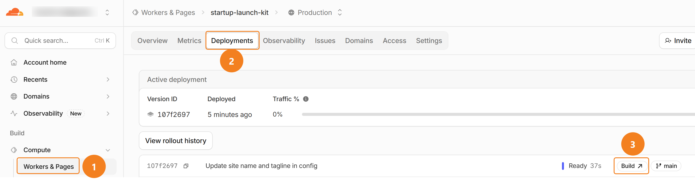

# Troubleshooting

Find your problem below. If nothing helps within 3 minutes, write in the webinar chat: what level and step you are on, and a screenshot.

- [Where to see logs](#where-to-see-logs)
- [The Deploy to Cloudflare button does not work](#the-deploy-to-cloudflare-button-does-not-work)
- [Build failed (red ✗)](#build-failed)
- [Name mismatch](#name-mismatch)
- [My changes don't show up](#my-changes-dont-show-up)
- [Database not created / waitlist errors](#database-not-created--waitlist-errors)
- [AI errors](#ai-errors)
- [Blog post errors](#blog-post-errors)
- [How to use the catch-up buttons](#how-to-use-the-catch-up-buttons)

## Where to see logs

There are two kinds of logs:

**1. Build log** (did my change get built and published?)

- On GitHub: on your repo's main page, click the small icon next to the latest commit (yellow dot = building, green ✓ = done, red ✗ = failed), then click **Details**.
- Or in Cloudflare: https://dash.cloudflare.com → **Workers & Pages** → your Worker → **Deployments** tab (or **Builds**) → click the latest build → **Build**.



Read the log from the **bottom up**. The real error is usually in the last red lines.

**2. Live logs** (what happens when someone uses my site?)

- https://dash.cloudflare.com → **Workers & Pages** → your Worker → **Observability** tab (or **Logs**). Messages like `API error:` or `Workers AI error:` appear here a few seconds after you use the form.

## The Deploy to Cloudflare button does not work

- **Check your emails are verified** on both GitHub (https://github.com/settings/emails) and Cloudflare (no yellow banner in the dashboard).
- **Log in to Cloudflare first**, then click the button again.
- **GitHub connection:** if you clicked "Only select repositories" before, Cloudflare may not be able to create a new repo. Go to https://github.com/settings/installations, open **Cloudflare Workers and Pages** → **Configure**, and choose **All repositories**, then try again.
- **"Repository already exists":** change the repository name on the setup page (for example `startup-launch-kit-2`).
- Try a different browser or a private/incognito window, and turn off ad blockers for this page.

## Build failed

You see a red ✗ next to your commit. Open the build log (see above) and look for these messages:

| What the log says | What to do |
| --- | --- |
| `name` ... does not match / mismatch | See [Name mismatch](#name-mismatch). |
| `Invalid Character "“"` (or `”`, `‘`, `’`) | Your text contains "curly" quotes, usually from pasting text from Word, Google Docs or a phone. In the GitHub editor, delete the quotes around your text and retype them with your keyboard as straight quotes `"`. |
| ``Expected `,` or `}` but found `Identifier` `` | A comma `,` is missing at the end of a line, usually the line **above** the one in the error. Add the comma back. |
| `Unterminated string` | A closing `"` is missing on that line. Add it back at the end of your text. If unsure, compare with the original: https://github.com/asazhin-dev/startup-launch-kit/blob/main/level-1/src/config.ts |
| `Could not resolve "worker/index.ts"` or `The entry-point file ... was not found` | The file `worker/index.ts` is missing or has a different name. Check that it is in a folder called `worker` (lowercase) and named `index.ts`. |
| Error in `wrangler.jsonc` (for example `InvalidSymbol`) | Part of the file was not pasted. Replace the whole file again, using **Copy raw file**. |
| Anything else | Copy the last 20 lines of the log into the webinar chat. |

After you fix the file, commit again. Each commit starts a new build.

## Name mismatch

The `"name"` line in your `wrangler.jsonc` must be **exactly** the name of your Worker in Cloudflare.

1. Find your Worker name: https://dash.cloudflare.com → **Workers & Pages**. The name is in the list (for most people: `startup-launch-kit`).
2. In your repo, open `wrangler.jsonc` → pencil icon ✏️.
3. Change the line so it uses that name, for example:

   ```jsonc
   "name": "startup-launch-kit",
   ```

4. Commit. The next build should pass.

## My changes don't show up

- Wait for the **green ✓** next to your commit, then refresh with Ctrl+F5 (Windows) or Cmd+Shift+R (Mac).
- Check you edited **your** repo, not the workshop repo. Your repo's address contains **your** GitHub username.
- Check you committed to the **main** branch (not a new branch or a pull request).
- Make sure you are looking at the right URL. If you used a catch-up button, you have a **new** URL.

## Database not created / waitlist errors

**The form says "Something went wrong on our side"** or `/api/waitlist/count` shows an error:

1. Check the build log of the commit where you replaced `wrangler.jsonc`. It should mention creating or binding a D1 database `startup-launch-kit-db`.
2. Check the database exists: https://dash.cloudflare.com → **Storage & databases** → **D1 SQLite Database**. You should see `startup-launch-kit-db`.
3. Check the Worker is connected to it: **Workers & Pages** → your Worker → **Settings** (or **Bindings**). You should see a binding `DB` → `startup-launch-kit-db`.
4. If the database is missing, make a small change to any file (for example add a space in `src/config.ts`) and commit, to start a new build.
5. Check the [live logs](#where-to-see-logs) for a line starting with `API error:`.

**The form says something like "Unexpected token" or "not valid JSON":** your website is calling `/api/waitlist` but there is no backend yet. Check that you did Part A and Part B of Level 2 (`worker/index.ts` exists and `wrangler.jsonc` contains `"main": "worker/index.ts"`).

**After a catch-up button, my waitlist already has emails in it.** That's expected. All levels use the same database name, `startup-launch-kit-db`, so the catch-up app connects to your existing database. Nothing is lost or duplicated.

**My `wrangler.jsonc` has a `database_id` line.** Leave it as it is. If it disappears when you replace the file, that's fine too: Cloudflare finds the database by its name.

**I don't see the form at all:** check that `enableWaitlist: true` in `src/config.ts`, wait for the green ✓, and refresh.

**How do I see the emails?** Only in the dashboard (they are private): **Storage & databases** → **D1 SQLite Database** → `startup-launch-kit-db` → **Explore Data** → select the `waitlist` table. (Or, in Explore Data, open the **Query** tab and run `SELECT * FROM waitlist ORDER BY created_at DESC;`)

If there is no `waitlist` table (or the query result says `no such table: waitlist`), nobody has used the form yet. Submit the form once, then look again.

## AI errors

**"The AI assistant is not available right now. Please wait a minute and try again."**

- Wait 30 seconds and click **Ask** again. AI models are sometimes busy.
- Check `wrangler.jsonc` contains the `"ai": { "binding": "AI" }` section (Level 3, Part B), and that the build after that commit has a green ✓.
- Check the [live logs](#where-to-see-logs) for a line starting with `Workers AI error:`.
- If the log mentions a daily limit or "neurons": you have used today's free Workers AI allowance (10,000 neurons, roughly 150 questions; an estimate). It resets every day at 00:00 UTC. This is unlikely during the workshop.

**"Please type a question between 2 and 500 characters."** Write a longer (or shorter) question.

**The form says "Unexpected token" or "not valid JSON" after turning on the assistant:** the backend for `/api/ask` is missing. Check Level 3 Part A (`worker/index.ts` replaced with the Level 3 version).

**The site or the answer still talks about Plovify (menu, plov FAQ, "Reserve your kazan").** Set `showPlovifyExamples: false` in `src/config.ts`, commit, and wait for the green ✓. The assistant uses your basics plus any `features`, `menu`, `steps` and `faq` you added yourself.

**The answer invents something (a price, a delivery date).** Add the correct fact to `faq` in `src/config.ts`. AI can still make mistakes; don't use it for anything binding.

**The answer is in the wrong language, mixes in words from other languages, or the format is strange.** Write a full sentence (very short questions are hard to detect; Azerbaijani can come back as Turkish) and click **Ask** again. AI output may mix in words from other languages (even other alphabets), and Uzbek quality varies; edit before using.

## Blog post errors

Only relevant if you did the optional blog bonus in Level 1. Open the build log and look for these messages:

| What the log says | What to do |
| --- | --- |
| `blog → my-first-post data does not match collection schema` and `pubDate: write the date like 2026-11-20` | The date is in the wrong format. Write it as year-month-day: `pubDate: 2026-11-20`. |
| `data does not match collection schema` and `title: Required` (or `description: Required`) | A line at the top is missing or misspelled. The top of the post needs `title:`, `description:` and `pubDate:` lines between the two `---` lines. |
| `pubDate must look like 2026-11-20` and every field is listed as missing | The first `---` line is missing. The file must start with `---` on its own line, and the settings must end with another `---` line. |
| `Missing closing "quote at line 2` | A closing `"` is missing on that line. Add it back. |

My post title shows curly quotes like `“Hello”`: you pasted text with curly quotes. Retype the quotes as straight quotes `"` in the GitHub editor.

My post does not appear on `/blog`: check the file is in `src/content/blog/`, its name ends in `.md`, and it does not contain `draft: true`. Then wait for the green ✓ and refresh.

## How to use the catch-up buttons

Each level has a **Stuck?** section with a catch-up button. It deploys a **finished** version of that level as a **new** project, so you can continue with the next level.

1. Click the catch-up button for the level you want to skip.
2. On the setup page, give the project a **new name** for both the repository and the Worker, for example `startup-launch-kit-l2`. (You already have `startup-launch-kit`, and names must be unique.)
3. Leave the build/deploy commands as they are and **keep the suggested database settings**. The catch-up app uses the same database name (`startup-launch-kit-db`), so it connects to the database you may already have. If you see emails from your earlier tests in the waitlist, that's fine and expected.
4. Click **Deploy** and wait for it to finish.
5. From now on, use the **new repo** (`https://github.com/<your-github-username>/startup-launch-kit-l2`) and the **new URL**.
6. Your texts are not copied. Open `src/config.ts` in the new repo and fill in your startup's basics again (name, tagline, description, accentColor, contactEmail, and `showPlovifyExamples: false` if you built your own startup), plus any other sections you changed. If you wrote a blog post, create it again in `src/content/blog/`.
7. In the next level, when you check the `"name"` line in `wrangler.jsonc`, it must be your **new** name (for example `startup-launch-kit-l2`).
